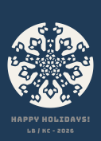

A laser-cut 5 × 7 in holiday card front: a five-fold snowflake (a symmetry real
ice crystals never have) filled with a Penrose rhombus tiling, hung in a round
window and attached to the card at its five arm tips.

## Build

```sh
./build.sh                # first run creates .venv and installs dependencies, then builds all presets -> out/
./build.sh bold           # one preset
./build.sh --preview      # also render PNG previews (first run downloads Chromium, ~90 MB)
```

Needs Python 3.9+ and Node.js (for the fonts). Edit the words in `text.json`, everything else in `generate.py`.

## Presets (edit `PRESETS` in generate.py)

| preset | struts | tile edge | look |
|---|---|---|---|
| `fine` | 1.0 mm | 3.6 mm | delicate lace |
| `bold` | 1.6 mm | 4.9 mm | heavier, easier to see, more forgiving to cut |

Handy knobs: `TIP_STYLE` (`leaf`/`flame`/`rhombus`), `CURL` (leaf bend), `stem_taper`, `ring_margin`
(keep leaves this far inside the window), `min_gap` / `min_bridge` (1 mm clearances), `strut` (bridge width), `L`/`N` (tile size = L / φᴺ), `ring`
(window radius), `center` (flake position), `card` (card size), `PAPER` / `BACKDROP` (preview colours only), `branches` (branch position, length, width, tip size).

## Lettering

The greeting is **engraved**, not cut. Edit `text.json` (the words, line width in mm, top y, spacing, and
`font`). Fonts are [Fontsource](https://fontsource.org) packages from npm (SIL OFL); `./build.sh` runs
`npm install` for you. To use another Google font, add `@fontsource/<name>` to `package.json` and set `"font": "<name>"`.

```sh
./build.sh --font=righteous       # whole build in one font -> out/fonts/righteous/
./build.sh --font-test --preview  # bold card in every font in FONT_TEST -> out/fonts/<font>/
```

## Output files (`out/`)

- `*-cutlines.svg`: grey filled lettering (engrave first), red hairline inner cuts, and a blue outline (cut last).
- `*-filled.svg`: the card as one filled shape with transparent cut-outs. Glowforge
  and Cricut-style software cut along every edge; set it to cut, not engrave.
- `*-preview.svg` / `.png`: how the card looks against a light backdrop. It is a single sheet of cardstock with
  holes cut through it; no insert or second layer is needed.

All units are millimetres; the SVGs import at true size.
